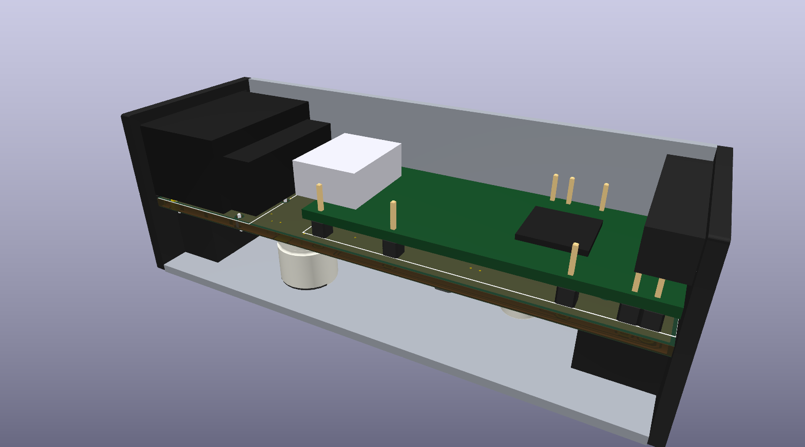
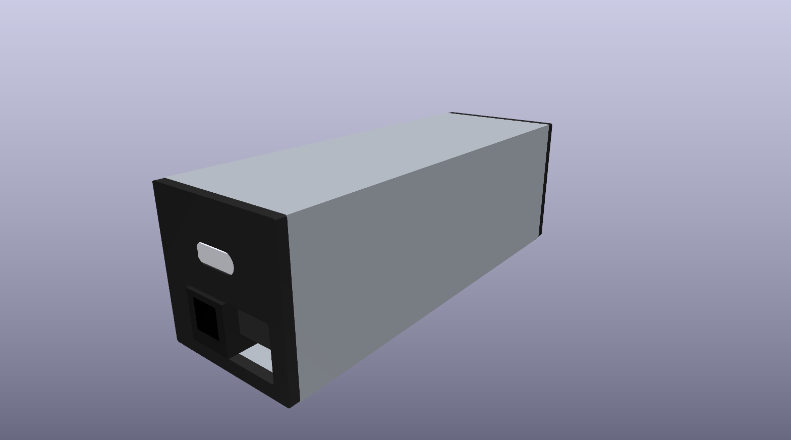
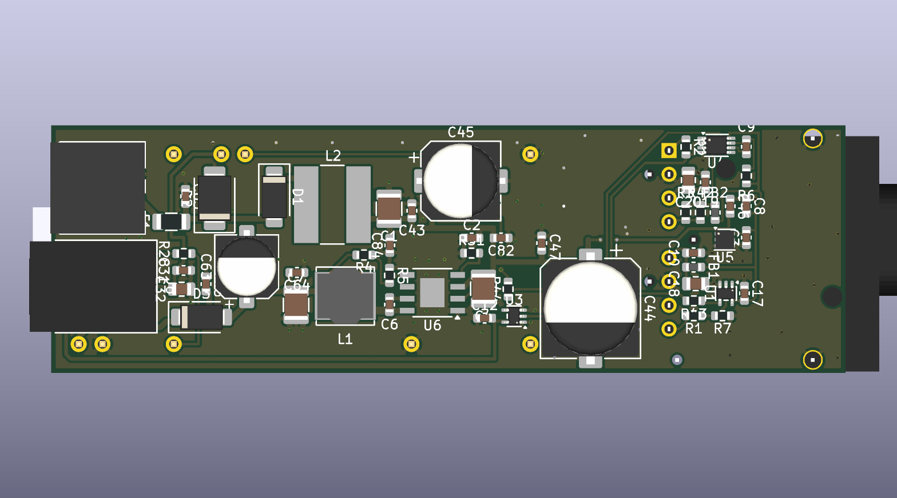
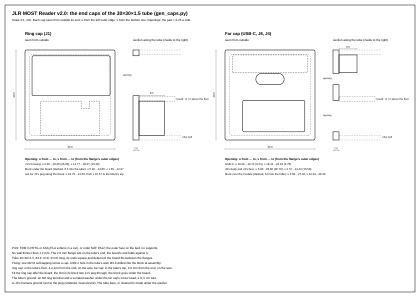

# JLR MOST Reader

A listen-only adapter for the MOST25 optical ring in Jaguar and Land Rover cars. It takes the stereo
the head unit sends to the factory amplifier and outputs it as S/PDIF on a TOSLINK socket, for an
aftermarket DSP or amplifier. **The car's own volume knob and steering-wheel buttons keep working:
the reader applies their level digitally, with no loss of quality** ([how](#volume-from-the-cars-own-controls-with-no-loss-of-quality)).
It can also log everything it sees on the ring to a laptop over USB.

**Status, 2026-10-11: designed and verified in simulation, but never built and never tried in a
car.** The author can't build it locally, so the whole design is published here for anyone who can.
Every file you need to order, flash and assemble one is in this repository.



Ukrainian: [README.uk.md](README.uk.md) has the decisions, the reasoning and the full project journal.

## Volume from the car's own controls, with no loss of quality

The audio on the ring travels before the volume: the factory amplifier applies volume and tone
itself. A plain MOST-to-TOSLINK tap would therefore play at full level, whatever the knob says.
The reader decodes the volume messages and applies the level itself, in the digital domain.

- **The stock controls keep working.** The knob and the steering-wheel buttons set the level as
  before. Navigation prompts and phone calls are mixed in at their own levels, and mute works.
- **Nothing is lost on the way:**
  - the 16-bit stereo is taken straight from the ring's frames, sample for sample;
  - the level is applied in 32-bit arithmetic (a 72-bit accumulator) and rounded once, to the
    24-bit output. Every bit of the 16-bit source survives down to 48 dB of attenuation, and the
    rounding sits at the 24-bit level, about 144 dB below full scale;
  - no resampling: the S/PDIF runs at the ring's own 48 kHz, one output frame per ring frame;
  - no DAC or ADC in between: the sound stays digital until your DSP or amplifier.
- **Level changes are smooth:** a new level settles in about 5 ms, without clicks.

Your DSP or amplifier can then run at a fixed gain, and the car's controls do the rest. One thing
is still open: if the XF's amplifier turns out to get the gateway's 0x409 levels rather than
SpeakerLevel in dB, their raw-to-dB curve has to be measured from a recording (see
[Status](#status-what-is-proved-and-what-is-not)).

## What it does

- **Not an amplifier emulator.** An emulator takes the factory amplifier's place on the ring and
  answers the head unit as the amplifier. This reader takes no place on the network: the factory
  amplifier stays in the ring and keeps working, and the reader listens to the stereo sent to it
  and processes it. In effect it is a MOST bus sniffer with an audio path.
- **Sits in the ring like any MOST device:** fibre in, fibre out. A loop-in adapter cable opens the
  ring at an existing node's connector.
- **Decodes the control channel:** Connect and DisConnect to the amplifier (node 0x186, FBlock
  0x22 AudioAmplifier, instance 0x05), SinkInfo, Mute, and the two volume messages seen so far
  (0x22.0x46D SpeakerLevel in dB, and the gateway's 0xF0.0x409 levels).
- **Plays four streams from the frames,** at the positions the Connect messages give: the main
  source; phone, navigation and voice prompts; the parking sensors; the chimes. These are the
  amplifier's sinks 1 to 4 as JLR uses them. Each stream gets its own level and mute: the
  parking sensors follow their own level setting, and the chimes keep a fixed level, so they can't
  disappear with the volume turned down.
- **Outputs S/PDIF:** 24-bit, at the ring's 48 kHz, IEC 60958-3 consumer format, through an
  Everlight T10 TOSLINK transmitter.
- **Logs to a laptop:** what it receives and what it decides, through the Tang Nano's USB-UART.
  The laptop tools (Python, Windows 10/11 and macOS) record a drive and decode it at home.
- **Never transmits on MOST** and has no address.

Hardware: a Sipeed Tang Nano 20K FPGA module (GW2AR-18) on a small carrier board, with a TE MOST FOT
header, power from the car's permanent 12 V (KL30), and a TOSLINK transmitter. The gateware runs on
one clock and replaces both the MOST chip and the host CPU that a design like this usually needs.

## Which cars

- **Target:** Jaguar XF X250 (2008-2015). The messages it decodes are the ones open projects
  recorded on JLR cars (see [SOURCES.md](SOURCES.md)).
- **What the car must have:** a MOST25 ring at 48 kHz, and a separate amplifier that receives its
  audio over that ring. The amplifier stays in place: it is the node the head unit sends the audio
  to.
- **Other cars:** other JLR models of the same generation with the same setup are candidates;
  Freelander 2 is the one with published evidence. Volume messages differ between models, and the
  logger exists to find that out.
- **Not other makes:** the Audi and BMW systems surveyed run their rings at 44.1 kHz and use
  different control messages.

## Is it safe for the car's ring?

The part that stays in the ring is small and separate from everything else:

```
ring in -> FOT receiver -> R1 -> U1 (one 74LVC1G34 buffer) -> R2 -> FOT transmitter -> ring out
```

- **The bypass:** U1 and the FOT run from their own 3.3 V regulator (TPS7B8133). It is fed
  straight from KL30 and is always on, drawing tens of microamps with the car parked. Nothing
  switches this path. It drives the transmitter the same way a powered OS8104 node in all-bypass
  does after reset.
- **Everything else is off that path:** the FPGA module, its 5 V buck converter (switched on by
  light arriving on the ring), the gateware and the TOSLINK output. If any of them fails, the ring
  still passes light. The FPGA's input is isolated by a 74LVC1G125 with Ioff, so an unpowered
  module doesn't load the line.
- **When the ring opens:** only if the bypass loses its permanent supply (a blown fuse, KL30
  disconnected). The same is true of every factory MOST node. Fit your own fuse where you tap KL30.
- **Nothing new on the network:** the reader sends nothing on MOST and has no address, so the car's
  network sees no new node.
- **Fully reversible:** unplug the loop-in adapter and the car is back to stock.
- **Start-up volume:** until the first volume message arrives, the main source plays at -12 dB, and
  phone/navigation, the parking sensors and the chimes at -6 dB. Keep your DSP's or amplifier's own gain low on the
  first drive.

## Status: what is proved and what is not

**Verified in models** (run `python check_all.py`; all 27 steps pass on the author's machine):

- The gateware, in Icarus Verilog against bit-exact Python models:
  - the control decoder, through five scenarios and 400 random blocks;
  - the frame timing at +-1000 ppm with jitter;
  - the DSP and the S/PDIF line, read back and decoded;
  - the whole reader from the optical line: a modelled JLR ring distorted to the edge of the MOST25
    receiver limits (SP4), through to the S/PDIF output;
  - the ring log, record by record, as far as the laptop's parser.
- The Gowin build meets timing with at least 10 % margin; the bitstream in `kit/2_fpga` was built
  from the committed sources.
- The boards:
  - KiCad ERC and DRC clean, with parity between schematic and board;
  - the v2.0 netlist compared with v1.0 part by part and net by net;
  - the board's fit in the tube and the end caps, all generated from one model (`reader_hw2/check_fit.py`).
- The decoder and the gain tables, cross-checked against C code written separately in the author's
  earlier project.

**Unknown until a bench or a car:**

- **Volume message:** which one the XF's amplifier actually gets. Both are decoded.
- **Connect:** whether the stock head unit sends 0x22.0x111 Connect at all.
- **The 0x409 levels:** their exact byte positions and level curve.
- **Real hardware:** how a real S/PDIF receiver locks to the output's edges, which sit on a
  1.26 ns grid, and whether the module's USB bridge sustains 3 Mbaud into Windows.

The log is designed to answer these on the first drive ([reader_gw/README.md](reader_gw/README.md),
[reader_gw/LOGGING.md](reader_gw/LOGGING.md)).

## Build one

The short version is below; the full guide is [BUILD.md](BUILD.md). There are two boards with the
same circuit. **v2.0** (`reader_hw2/`) is the one to build:
84.9 x 26.5 mm, two layers, inside a 30 x 30 x 1.5 mm aluminium tube with two 3D-printed end caps.
v1.0 (`reader_hw/`) is a flat 77.5 x 55.6 mm board with mounting holes.





1. **Measure first.** The end caps depend on the tube's inside (27.0 mm nominal), how far the
   module's HDMI and USB-C stick out past its board (4 and 2 mm assumed), and J4's tail length
   (3.0 mm assumed). The list is in `reader_hw2/kit/1_boards/README.md`, "Перед замовленням виміряти".
2. **Order the boards** from JLCPCB. Everything is in `reader_hw2/fab/`.
   - Board: `most_reader_v2-gerbers.zip`. 2 layers, 1.6 mm, 1 oz, ENIG; U4, U5 and U6 need flat pads.
   - Assembly: the bottom side only, with `most_reader_v2-bom-jlcpcb.csv` and
     `most_reader_v2-cpl-jlcpcb.csv`. That is 30 lines and 52 parts, every one with its LCSC number.
   - In their placement preview, check pin 1 of U1, U3, U4, U5 and U6, and the polarity of D1, D2,
     D3, C44, C45 and C63.
3. **Buy the hand-soldered parts:**

   | Ref | Part | Note |
   |---|---|---|
   | J1 | TE 1-1394640-1, MOST pigtail FOT header (2+0) | not stocked by Mouser or DigiKey; marketplaces only, look early |
   | J4 | Molex 43650-0200, Micro-Fit 3.0 right angle; mating 43645-0200 and two 43030 terminals | 12 V from KL30 |
   | J6 | Everlight PLT237/T10WH | DigiKey 1080-PLT237/T10WH-ND |
   | M1 | Sipeed Tang Nano 20K | with its pin headers, cut to nine pins |

   You also need:
   - a 30 x 30 x 1.5 aluminium tube, 84.9 mm (+0.2/-0) long, best left bare;
   - two M2 x 6 self-tapping screws, an M2 ring terminal and a serrated washer for the tube's ground;
   - four 4.2 mm self-tapping screws (DIN 7981) or M4 screws to fix it in the car;
   - a MOST loop-in adapter for the node you will tap, as made by Kufatec, Dension or Trioma;
   - a TOSLINK cable.
4. **Flash the FPGA** before soldering the module: write `kit/2_fpga/reader.fs` to its flash. On
   Windows use Gowin Programmer; on macOS, `openFPGALoader -b tangnano20k -f --verify reader.fs`.
   The module's BL616 bridge needs firmware 2025030317 or newer (`kit/2_fpga/README.md`).
5. **Solder:**
   - J6 and J4 from below, with their leads cut flush where the module will sit;
   - J1 on top at the ring edge;
   - M1 last, on nine header pins only: 5, 7, 8, 20 and 21, 22, 25, 35, 40. Cut the strips into
     pieces (5 | 7-8 | 20 and 21-22 | 25 | 35 | 40) and let the board hold them square.
6. **Bench:**
   - Check for shorts across J4, C3 and C63, then power from a current-limited 12 V supply.
     C3 shows 3.3 V at all times.
   - With light into J1, C63 shows about 5.3 V and the module starts.
   - Then record on the bench with the laptop tools (`kit/3_laptop/`).
7. **Tube:**
   - Print the caps from `reader_hw2/caps/` in PETG or ASA. The drawing is
     [caps_en.svg](reader_hw2/caps/caps_en.svg).
   - Fit the far cap, slide the board in from the ring end until it meets the far cap, then fit
     the ring cap; one screw each.
   - Run a short wire from the far cap's screw to J4's ground at the plug.
   - Each cap runs on under the tube into a saddle with an ear on either side. The tube's floor
     rests on the two saddles, and four screws through the ears hold the reader in the car.
8. **Car:**
   - First the bypass alone: the reader in the ring, powered, and the car must sound exactly as before.
   - Then a drive with the log running.

**The full step-by-step guide in English is [BUILD.md](BUILD.md).** The same instructions in
Ukrainian are the kit's: [reader_hw2/kit/README.md](reader_hw2/kit/README.md),
[reader_hw2/kit/1_boards/README.md](reader_hw2/kit/1_boards/README.md),
[kit/2_fpga/README.md](kit/2_fpga/README.md) and [kit/3_laptop/README.md](kit/3_laptop/README.md).
The board and its design choices are described in [reader_hw2/README.md](reader_hw2/README.md).



## Rough cost

| Item | Approx. USD | Basis |
|---|---|---|
| JLCPCB: 5 boards, 2 of them assembled | 60-100, plus shipping and tax | their price page (Sept 2025): $8 setup and $3 per extended part type (about 15 here), plus the parts and the ENIG boards |
| Sipeed Tang Nano 20K | 25-35 | $25 at launch; resellers $27-36 |
| TE 1-1394640-1 | unknown | marketplaces only |
| T10 transmitter, Micro-Fit pair, tube, printed caps, screws | 15-25 | rough |
| MOST loop-in adapter, TOSLINK cable | 25-60 | rough; depends on the node you tap |

The first reader comes to roughly $130-220 plus J1. The second board from the same order costs
only its hand parts and cables.

## Repository map

| Path | What |
|---|---|
| `reader_hw2/` | **v2.0 board** (KiCad 10): generators, the board, `fab/` for JLCPCB, `caps/` for the tube, `views/` pictures, `kit/` instructions |
| `reader_hw/` | v1.0 board, same circuit, flat with mounting holes |
| `reader_gw/` | gateware for the Tang Nano 20K: RTL, simulations, the Gowin build |
| `kit/` | what a builder takes away: v1.0 fab files, the bitstream, the laptop tools |
| `virtual_most_source/` | a Python model of a MOST25 ring and of JLR's messages, which the simulations use |
| `tools/` | checks: sheet, board, pins, cross-checks, the kit's builder, the laptop's logger and decoder |
| `check_all.py` | every check in turn |

Tools: KiCad 10, Python 3, OSS CAD Suite (Icarus Verilog) for the simulations, and Gowin EDA
1.9.12.03 to rebuild the bitstream (the committed one is ready to flash). Two cross-check steps
need the author's earlier, unpublished project and fail without it ([SOURCES.md](SOURCES.md)).

## Licence

Copyright 2026 Oleg-mk.

- **Hardware, under CERN-OHL-S-2.0** ([LICENSE](LICENSE)):
  - `reader_hw/`, `reader_hw2/` (the KiCad design and the scripts that generate it, footprints,
    3D models, fabrication files, end caps);
  - the gateware in `reader_gw/rtl/` and `reader_gw/board/`;
  - `kit/1_boards/` and `kit/2_fpga/`.
- **Software, under GPL-3.0-or-later** ([COPYING](COPYING)):
  `virtual_most_source/`, `tools/`, `reader_gw/sim/`, `kit/3_laptop/` and `check_all.py`.
- **Documentation:** each README and drawing is under the licence of the directory it sits in.

If you build or change the hardware and share it, share your sources under the same licence.

## How it was made

The author made the decisions and placed the parts. Claude (Anthropic's AI model,
in Claude Code) wrote the gateware, the models and simulations, the board generators and copper,
and the checks, as a co-author. The commit history shows both.
